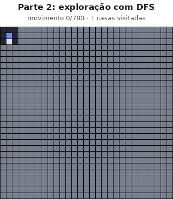
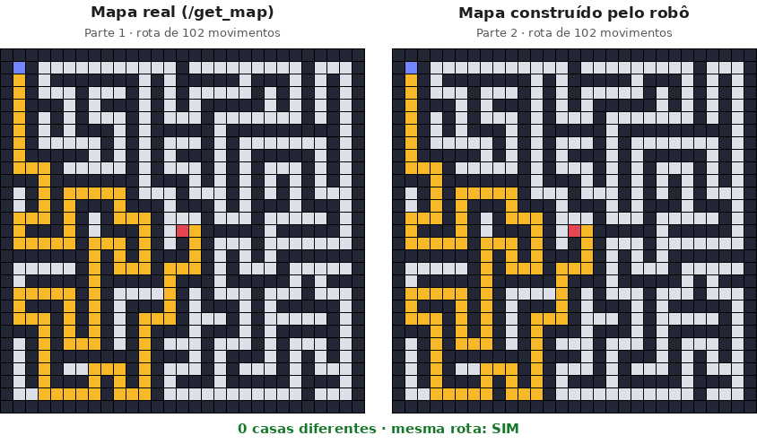
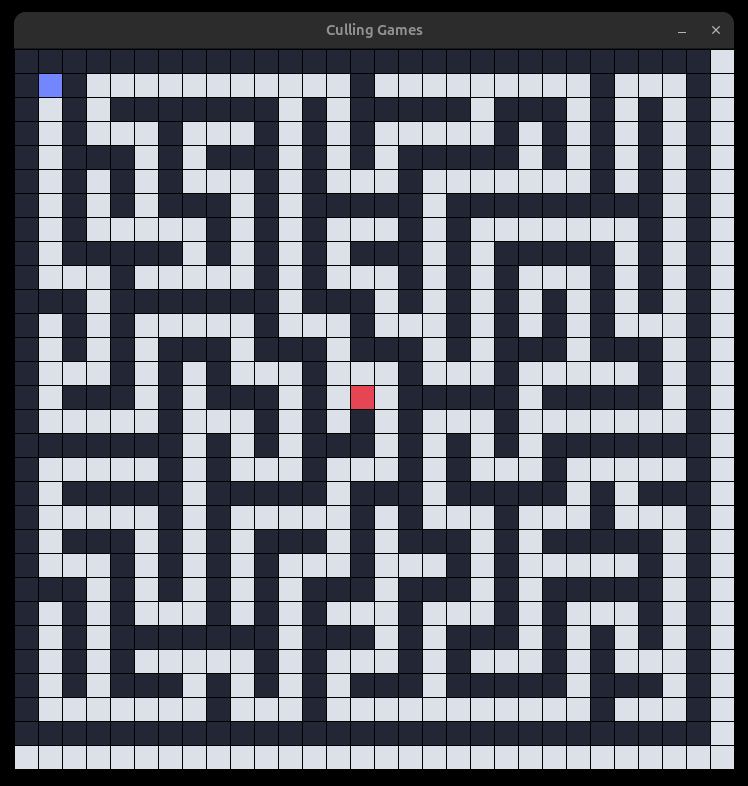
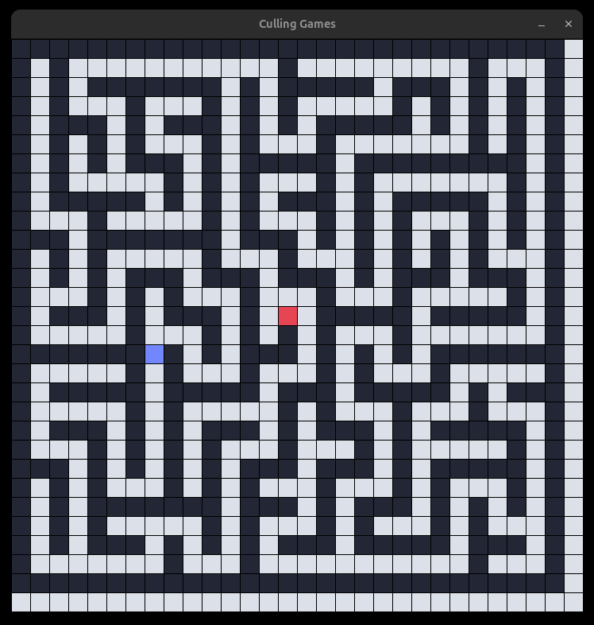
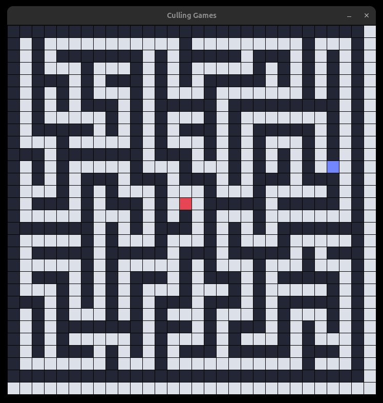
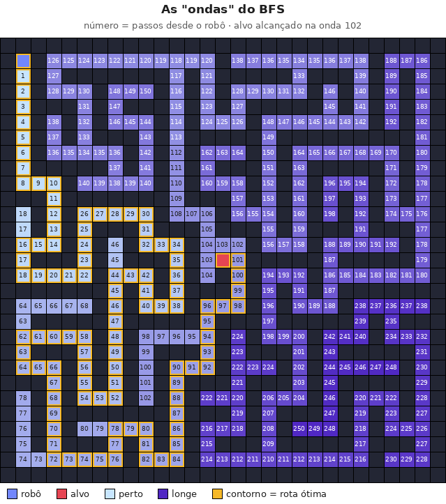
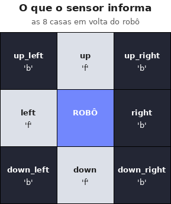
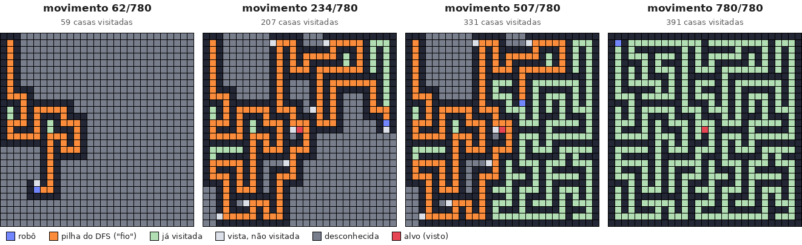

# Navegação Autônoma em Labirinto (ROS 2)

Solução do **Desafio de Navegação Autônoma**: um robô dentro de um labirinto precisa chegar até um alvo usando algoritmos de grafos, no simulador **Culling Games** ([rmnicola/culling_games](https://github.com/rmnicola/culling_games)).



*O robô explorando um labirinto que ele não conhece (Parte 2). O cinza é o que ele ainda não viu; o laranja é o "fio" que ele usa para voltar.*

## Sumário

1. [O desafio](#o-desafio)
2. [Resultados](#resultados)
3. [Vendo o jogo funcionar](#vendo-o-jogo-funcionar)
4. [Como o repositório está organizado](#como-o-repositório-está-organizado)
5. [Como rodar](#como-rodar)
6. [Como funciona](#como-funciona)
   - [Como o programa conversa com o jogo](#como-o-programa-conversa-com-o-jogo)
   - [O labirinto como um grafo](#o-labirinto-como-um-grafo)
   - [Parte 1: BFS, a rota mais curta](#parte-1-bfs-a-rota-mais-curta)
   - [Parte 2: DFS, explorar e mapear](#parte-2-dfs-explorar-e-mapear)
   - [A comprovação](#a-comprovação)
7. [Devlog: como o projeto evoluiu](#devlog-como-o-projeto-evoluiu)
8. [O que veio pronto e o que foi feito](#o-que-veio-pronto-e-o-que-foi-feito)
9. [Como as imagens deste README foram feitas](#como-as-imagens-deste-readme-foram-feitas)
10. [Créditos e licença](#créditos-e-licença)

---

## O desafio

| | Parte 1: navegação **com** mapa | Parte 2: mapeamento **sem** mapa |
|---|---|---|
| O que o robô sabe | O mapa completo do labirinto | Nada. Só o que os sensores mostram ao redor dele |
| O que ele faz | Calcula a rota mais curta e vai até o alvo | Explora o labirinto inteiro, desenha o próprio mapa e depois calcula a rota |
| Algoritmo | **BFS** (busca em largura) | **DFS** (busca em profundidade) para explorar + **BFS** para a rota |
| O que precisa provar | Que a rota é a mais curta | Que o mapa construído basta para refazer a rota da Parte 1 |

---

## Resultados

Resultados no mapa `1.csv` (29 × 29 casas):

| | Parte 1 | Parte 2 |
|---|---|---|
| Rota mais curta até o alvo | **102 movimentos** | **102 movimentos** ✅ |
| Movimentos gastos explorando | — | 780 |
| Casas do mapa construído diferentes do mapa real | — | **0 de 841** |
| Pisou no alvo durante a exploração? | — | Não |
| Tempo (com a janela do jogo aberta) | ~5 s | ~16 s explorando + ~5 s até o alvo |



À esquerda está o mapa real, que a Parte 1 pede ao jogo. À direita está o mapa que o robô construiu **sozinho** na Parte 2. Os dois são idênticos, e a rota calculada em cada um (em amarelo) é exatamente a mesma. Os arquivos que comprovam isso estão na pasta [`resultados/`](resultados/).

Rota mais curta nos outros mapas (Parte 1):

| Mapa | 1 | 2 | 3 | 4 | 5 | 6 | 7 | 8 | 9 | 10 |
|---|---|---|---|---|---|---|---|---|---|---|
| Movimentos | 102 | 102 | 192 | 114 | 204 | 110 | 96 | 164 | 190 | 48 |

---

## Vendo o jogo funcionar

Prints reais da janela do jogo durante a execução. O **azul** é o robô, o **vermelho** é o alvo, o **escuro** são as paredes e o **claro** são as casas livres.

| Antes de começar | Parte 1: indo pela rota mais curta | Parte 2: explorando |
|---|---|---|
|  |  |  |
| O robô começa no canto (1,1) e o alvo fica no centro (14,14). | Depois de 3 segundos, o robô já percorreu boa parte das 102 casas da rota. | O robô está explorando o lado direito. A janela não mostra o que ele já sabe; isso aparece na [animação](#parte-2-dfs-explorar-e-mapear). |

E é isto que aparece no terminal durante a **Parte 1**: o mapa desenhado com a rota marcada (`••`):

```
[parte1]: Mapa recebido: 29 linhas x 29 colunas
[parte1]: Robô em (1, 1) | Alvo em (14, 14)  (linha, coluna)
[parte1]: Rota ótima encontrada: 102 movimentos
██████████████████████████████████████████████████████████
██RR██                      ██                  ██      ██
██••██  ██████████████  ██  ██████████  ██████  ██  ██  ██
██••██      ██      ██  ██  ██          ██  ██  ██  ██  ██
██••██████  ██  ██████  ██  ██  ██████████  ██  ██  ██  ██
...
Direções: down down down down down down down down right right down down ...
[parte1]: Executando a rota...
[parte1]: ALVO ALCANÇADO em 102 movimentos (5.3 s)
```

---

## Como o repositório está organizado

```
navegacao_autonoma/
├── src/
│   ├── cg/              ← o jogo (simulador), do professor
│   ├── cg_interfaces/   ← os "formulários" de comunicação com o jogo, do professor
│   ├── cg_teleop/       ← controle pelo teclado, do professor (com um ajuste, ver abaixo)
│   └── cg_solver/       ← ★ A NOSSA SOLUÇÃO
│       └── cg_solver/
│           ├── parte1.py     → programa da Parte 1
│           ├── parte2.py     → programa da Parte 2
│           ├── bfs.py        → algoritmo BFS (usado pelas duas partes)
│           ├── labirinto.py  → funções para montar e desenhar o mapa
│           ├── arquivos.py   → salva e lê mapas e rotas na pasta resultados/
│           └── ola.py        → programa de teste ("olá mundo")
├── resultados/          ← o que os programas salvaram (a comprovação)
│   ├── parte1_mapa.csv             → mapa real
│   ├── parte1_rota.json            → rota da Parte 1
│   ├── parte2_mapa_construido.csv  → mapa que o robô construiu
│   ├── parte2_rota.json            → rota da Parte 2
│   └── parte2_exploracao.json      → trajeto completo da exploração
├── docs/
│   ├── img/                 → imagens deste README
│   ├── gerar_imagens.py     → desenha as imagens a partir de resultados/
│   └── xwd_para_png.py      → converte os prints da janela do jogo
├── lobotomy_kaisen/     ← imagens usadas pelo jogo, do professor
└── README.md
```

---

## Como rodar

### 1. O que precisa estar instalado

- Ubuntu 24.04 com **ROS 2 Jazzy**
- `colcon` (ferramenta que monta os pacotes)
- `pygame` (biblioteca gráfica que o jogo usa):
  ```bash
  sudo apt install python3-pygame
  ```

### 2. Baixar e montar (compilar) o projeto

```bash
git clone https://github.com/mavisanttos/navegacao_autonoma.git
cd navegacao_autonoma
colcon build
source install/setup.bash
```

> **Importante:** todo terminal novo precisa do `source install/setup.bash`, que é o que "apresenta" os nossos pacotes ao terminal. Rode os comandos sempre **da pasta raiz do repositório**, porque é nela que a pasta `resultados/` é criada.

### 3. Abrir o jogo (Terminal 1)

```bash
source install/setup.bash
ros2 run cg maze -- --map 1.csv
```

Troque `1.csv` por outro mapa (de `1.csv` a `10.csv`) ou use `-- --generate` para gerar um labirinto aleatório.

### 4. Parte 1 (Terminal 2)

```bash
source install/setup.bash
ros2 run cg_solver parte1
```

O programa mostra a rota no terminal, salva o mapa e a rota em `resultados/` e leva o robô até o alvo.

### 5. Parte 2 (Terminal 2)

Para começar do zero, reinicie o jogo antes. Depois de uma vitória, o jogo recusa novos movimentos.

```bash
ros2 service call /reset cg_interfaces/srv/Reset "{is_random: false}"
ros2 run cg_solver parte2
```

O robô explora o labirinto todo, desenha o mapa que construiu, calcula a rota, **compara com a Parte 1** e vai até o alvo.

> Para a comparação automática funcionar, rode a Parte 1 e a Parte 2 **no mesmo mapa**.

### 6. (Opcional) Gerar as imagens deste README

Depois de rodar as duas partes:

```bash
python3 docs/gerar_imagens.py
```

### 7. (Opcional) Controlar o robô pelo teclado

```bash
ros2 run cg_teleop teleop_keyboard
```
Use **W A S D** ou as **setas**. A tecla `r` reinicia o mapa e `n` carrega um mapa aleatório.

---

## Como funciona

### Como o programa conversa com o jogo

O jogo e a nossa solução são programas separados (no ROS, cada um é um **nó**) que trocam mensagens. Existem dois jeitos de conversar:

- **Serviço:** funciona como fazer um pedido no balcão. Você pede, o jogo responde, uma vez.
- **Tópico:** funciona como ouvir uma rádio. O jogo transmite o tempo todo e quem quiser escuta.

```
            ┌──────────── serviços (pedido → resposta) ───────────┐
            │  /get_map       "me dá o mapa"     → mapa (só Parte 1)
  NOSSO     │  /move_command  "anda pra cima"    → deu certo? onde estou?
  PROGRAMA ─┤  /reset         "recomeça"         → ok
 (cg_solver)│                                                       JOGO (cg)
            │◄─── tópico /culling_games/robot_sensors (100x por segundo) ───
            └──────── "em volta do robô tem: parede, livre, alvo..." ───────┘
```

| Nome | Tipo | Para que usamos | Parte |
|---|---|---|---|
| `/get_map` | serviço | Pedir o mapa completo | Só na 1 |
| `/move_command` | serviço | Mover o robô 1 casa. A resposta diz se deu certo e onde o robô está | 1 e 2 |
| `/reset` | serviço | Reiniciar o mapa | 1 |
| `/culling_games/robot_sensors` | tópico | Ver o que há nas 8 casas em volta do robô | Só na 2 |

**Por que mover é serviço e o sensor é tópico?** Cada movimento precisa de confirmação ("deu certo?"), então é pedido e resposta. Já o sensor muda o tempo todo, então o jogo simplesmente transmite sem parar.

### O labirinto como um grafo

O mapa é uma grade de casas: `b` = parede, `f` = livre, `r` = robô, `t` = alvo. Para os algoritmos, ele vira um **grafo**, que é só um monte de **pontos ligados por linhas**:

- cada **casa livre** é um ponto (vértice);
- duas casas livres **vizinhas** (em cima, embaixo, à esquerda ou à direita) são ligadas por uma linha (aresta). Diagonal não vale, porque o robô não anda na diagonal;
- todo passo custa o mesmo: **1 movimento**.

### Parte 1: BFS, a rota mais curta

**Passo a passo:**

1. Pede o mapa ao jogo (`/get_map`). Ele chega "achatado", como uma lista única com as 841 casas, e é remontado em 29 linhas de 29 casas.
2. Roda o **BFS (busca em largura)** para achar a rota mais curta.
3. Transforma a rota em comandos (`up`, `down`, `left`, `right`) e manda o robô andar, um passo por vez. **A cada passo confere** se o robô está mesmo onde deveria; se não estiver, para e avisa.

**Como o BFS pensa:** ele explora o labirinto **em ondas**, como uma pedra jogada num lago. Primeiro marca todas as casas a 1 passo do robô, depois todas a 2 passos, depois a 3, e assim por diante. Na imagem abaixo, cada número é a onda em que a casa foi alcançada:



O alvo foi alcançado na **onda 102**. Como as ondas avançam um passo de cada vez, **não existe jeito de chegar antes**: essa é, garantidamente, a rota mais curta. Para montar a rota, o BFS lembra de onde veio cada casa (como migalhas de pão) e volta do alvo até o robô.

> Isso só funciona porque todos os passos custam igual. Se alguns passos custassem mais (por exemplo, atravessar lama), seria preciso outro algoritmo, como o Dijkstra.

### Parte 2: DFS, explorar e mapear

Aqui o robô **não pode** pedir o mapa. Ele só tem:

- **os sensores**, que dizem o que há nas 8 casas em volta dele;
- **a própria posição**, que vem na resposta de cada movimento.



**Passo a passo:**

1. **Onde estou?** O robô "esbarra" numa parede que o sensor já mostrou. O jogo recusa o movimento, mas a resposta traz a posição atual. Assim ele descobre onde está sem gastar nenhum passo.
2. **Explorar com DFS (busca em profundidade).** Funciona como explorar uma caverna com um **novelo de lã**: o robô segue por um corredor enquanto houver casa nova, desenrolando o fio. Quando chega num beco sem saída, **volta pelo mesmo caminho**, enrolando o fio (*backtracking*), até o último ponto que ainda tinha passagem nova.
3. Em cada casa, ele anota no seu próprio mapa tudo o que os sensores mostram.
4. Quando volta ao ponto de partida sem nada novo para ver, o labirinto inteiro foi mapeado.

Veja a exploração em 4 momentos:



- O **laranja** é o "fio de lã" (no código, uma **pilha**): o caminho do ponto de partida até onde o robô está. Ele cresce quando o robô avança e diminui quando o robô volta.
- O **verde** são as casas por onde ele já passou.
- O **cinza** é o que ele ainda não viu.
- O **vermelho** é o alvo. O robô o vê pelos sensores logo no início, mas **nunca pisa nele**, porque pisar encerraria o jogo e ele não poderia terminar de explorar.

**Por que foram 780 movimentos?** O robô visitou 391 casas, e cada "trecho" entre duas casas foi percorrido **duas vezes**: uma indo e outra voltando. São 390 trechos, então 2 × 390 = **780**.

**Dois cuidados importantes:**

- **Esperar a leitura nova do sensor.** O sensor não diz *onde* o robô está, só o que há em volta. Se o robô andasse e usasse a leitura antiga, anotaria as paredes no lugar errado, como descrever uma foto tirada antes de dar o passo. Por isso, depois de cada passo, o programa espera chegarem leituras novas.
- **Casa desconhecida conta como parede.** Na hora de calcular a rota, o robô só confia no que viu. Assim a rota nunca atravessa uma parede que ele não conferiu.

### Por que DFS para explorar e BFS para a rota?

| | DFS (profundidade) | BFS (largura) |
|---|---|---|
| Como explora | Mergulha num caminho até o fim, depois volta | Em ondas, tudo a 1 passo, depois a 2... |
| Acha o caminho mais curto? | **Não** | **Sim** |
| Bom para um robô de verdade explorar? | **Sim**: o próximo lugar está sempre ao lado | Não: o próximo lugar pode estar do outro lado do mapa |
| Onde usamos | Parte 2, para **mapear** | Partes 1 e 2, para **calcular a rota** |

### A comprovação

Depois de mapear, a Parte 2 roda **exatamente o mesmo código de BFS** da Parte 1, só que no mapa que o robô construiu. Em seguida, compara com o que a Parte 1 salvou e mostra:

```
[parte2]: Exploração concluída em 15.6 s: 780 movimentos, 391 células visitadas, mapa 29x29, 0 células desconhecidas
[parte2]: Alvo encontrado em (14, 14) (sem pisar nele)
[parte2]: Rota ótima no mapa construído: 102 movimentos
=========== COMPROVAÇÃO: Parte 1 x Parte 2 ===========
Mapa: 0 células diferentes do mapa real (29x29 = 841 células)
Rota Parte 1 (mapa real):       102 movimentos
Rota Parte 2 (mapa construído): 102 movimentos
MESMO TAMANHO: o mapa construído é suficiente para reproduzir a rota ótima da Parte 1. ✅
(E a sequência de direções é idêntica.)
=======================================================
[parte2]: Executando a rota calculada no mapa construído...
[parte2]: ALVO ALCANÇADO em 102 movimentos usando só o mapa construído pelo robô!
```

A Parte 1 só é consultada **depois** que o mapeamento terminou, para conferir o resultado, como corrigir a prova com o gabarito depois de entregá-la. Ela nunca é usada para guiar o robô.

Também não é preciso reiniciar o jogo para o robô ir até o alvo: ao fim da exploração ele já voltou ao ponto de partida (o "fio" foi todo enrolado), e o jogo não foi vencido.

---

## Devlog: como o projeto evoluiu

### 21/11: preparação
- **Ambiente conferido:** Ubuntu 24.04 com ROS 2 Jazzy e `colcon` instalados. Faltava o `pygame`, que o jogo usa para desenhar a janela; ele foi instalado com `apt`.
- **Workspace montado:** os pacotes do professor (`cg`, `cg_interfaces`, `cg_teleop`) e a pasta de imagens foram copiados para este repositório e compilados com `colcon build`. Jogo, serviços e sensores testados.
- 🐛 **Teleop com teclas estranhas:** o menu mostrava `u i o j k l m , .` e as setas não funcionavam. Causa: cada seta do teclado envia **3 caracteres**, e o programa lia só 1; o menu tinha sido copiado de outro programa. Consertado e traduzido.
- **Pacote `cg_solver` criado**, com um nó de teste (`ola`) para confirmar que tudo estava ligado.

### 21/11: Parte 1
- **Mapa recebido:** o nó pede o mapa e remonta a lista achatada em linhas e colunas. O desenho no terminal bateu com o arquivo `1.csv`.
- **BFS implementado** e testado nos 11 mapas, **sem o jogo**: todas as rotas são válidas (começam no robô, terminam no alvo, andam 1 casa por vez e nunca atravessam parede).
- **Robô andando:** a rota vira comandos e o robô chega ao alvo em 102 movimentos, conferindo cada passo.
- 🐛 **O reset "mentia":** depois de pedir `/reset`, o mapa ainda vinha sem o alvo. Descobrimos que o jogo só **agenda** o reset e o aplica um instante depois. Solução: pedir o mapa de novo até o alvo reaparecer.
- 🐛 **Robô lento nos testes:** cada passo levava até 1 segundo. Em vez de adivinhar, **medimos**: o problema só acontecia rodando o jogo **sem janela** (modo de teste). Com a janela aberta, cada passo leva ~4 milésimos de segundo. Decisão: não mexer no jogo do professor.

### 21/11: Parte 2
- **Sensores:** o nó passou a ouvir o tópico dos sensores. Detalhe crucial: é preciso usar **a mesma configuração de entrega (QoS)** do jogo; com a configuração padrão, nenhuma mensagem chega, e sem aviso de erro. Medido: ~100 leituras por segundo.
- **Exploração com DFS:** o robô descobre a própria posição "esbarrando" numa parede, explora tudo sem pisar no alvo e espera leituras novas a cada passo. Resultado: **mapa 100% igual ao real** na primeira execução, em 780 movimentos.
- **Comprovação:** a Parte 2 roda o mesmo BFS no mapa construído e compara com a Parte 1: **102 = 102**, com as mesmas direções.
- Primeira versão deste README.

### 27/11: documentação visual
- A Parte 2 passou a salvar o **trajeto completo** da exploração (`resultados/parte2_exploracao.json`).
- Criado `docs/gerar_imagens.py`, que desenha as imagens deste README (ondas do BFS, progresso da exploração, animação e comparação) **a partir dos resultados reais**, com as mesmas cores do jogo.
- Prints reais da janela do jogo capturados durante uma execução.
- README ampliado com imagens, explicações e este devlog.

### Lições aprendidas
- **Medir antes de concluir:** a lentidão parecia culpa do nosso código, mas as medições mostraram que vinha do modo de teste sem janela.
- **"Respondeu ok" não é "já terminou":** o reset do jogo mostrou que é preciso conferir o estado, não só a resposta.
- **Conferir cada passo** (posição real × posição esperada) evitou que o robô se perdesse sem perceber.
- **Separar a lógica da comunicação:** o BFS não depende do ROS, então foi testado sozinho e reaproveitado nas duas partes sem mudar nada.

---

## O que veio pronto e o que foi feito

- **Do professor (sem alterações):** os pacotes `cg` (jogo), `cg_interfaces` (comunicação) e a pasta `lobotomy_kaisen` (imagens), copiados de [rmnicola/culling_games](https://github.com/rmnicola/culling_games).
- **Do professor, com um ajuste:** `cg_teleop`. As **setas do teclado não funcionavam** (o programa lia só 1 dos 3 caracteres que cada seta envia) e o menu mostrava teclas que não eram as usadas. As setas foram consertadas, o controle ficou com W A S D e o menu foi traduzido. Esse pacote é só um controle de teste e não faz parte da solução.
- **Feito neste trabalho:** todo o pacote `cg_solver`, a pasta `resultados/` e a pasta `docs/`.

---

## Como as imagens deste README foram feitas

- **Prints da janela do jogo** (`docs/img/jogo_*.png`): capturados com o `xwd` enquanto os programas rodavam, e convertidos para PNG com [`docs/xwd_para_png.py`](docs/xwd_para_png.py):
  ```bash
  xwd -name "Culling Games" -silent > captura.xwd
  python3 docs/xwd_para_png.py captura.xwd docs/img/jogo_inicio.png
  ```
- **Imagens explicativas e animação** (`bfs_ondas`, `parte1_rota`, `sensores`, `parte2_progresso`, `parte2_exploracao.gif`, `comparacao`): desenhadas por [`docs/gerar_imagens.py`](docs/gerar_imagens.py) a partir dos arquivos de `resultados/`, ou seja, mostram **exatamente** o que o robô fez na execução real.

---

## Créditos e licença

Simulador Culling Games © 2024 Rodrigo Nicola, licença MIT (ver [`LICENSE-culling_games`](LICENSE-culling_games)). O pacote `cg_solver` também usa a licença MIT.
